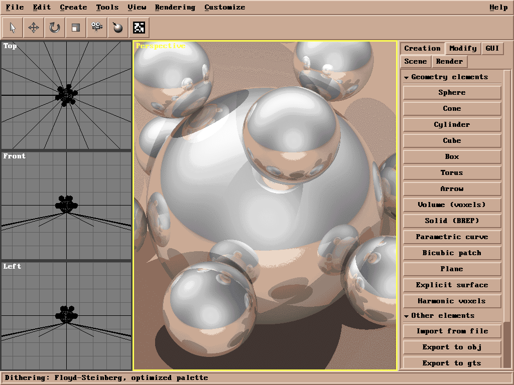

# Vitral Kernel

Vitral Kernel is a small, preemptive SMP kernel for x86, written primarily in C++. The same kernel and programs run in x86_64 long mode or i386 protected mode. It runs parallel workloads, including Vitral's ray tracer, to compare their operating-system overhead with conventional operating systems.

All processes run in ring 0 in one address space. Programs are compiled into the image. System calls that can block use `int 0x80` with a C++ ABI, because only its frame lets the scheduler switch processes; the others (console, process ids, time) and the video functions are plain calls. There is no process isolation, executable loader, `fork`, users, permissions or signal delivery; a program fault can bring down the kernel. The x86_64 build uses an identity-mapped address space, with the frame buffer marked write-combining when the CPU has PAT; i386 runs without paging, so its frame buffer stays uncached.

## SceneEditorApplication on real hardware



SceneEditorApplication running on the minimalistic kernel on a real 32-bit machine with an AMD Athlon XP 2000+ and an Nvidia GeForce 7600 GS GPU. The screenshot uses a 256-color mode with a custom palette and Floyd–Steinberg dithering.

## Build and run

The build requires CMake, LLVM (`clang`, `clang++`, `ld.lld`, `llvm-objcopy`), mtools and the Vitral base library at `../base`. QEMU is needed to run the images. On macOS:

```sh
brew install cmake qemu llvm lld mtools
```

```sh
scripts/run64.sh          # x86_64, one CPU per online host logical CPU
scripts/run64smp.sh       # x86_64 SMP, one CPU per online host logical CPU
scripts/run64smpSVGA.sh   # one CPU per online host logical CPU, Bochs VBE and more graphics memory
scripts/run32.sh          # i386, one CPU per online host logical CPU
scripts/run32failon64.sh  # verify rejection of a CPU without long mode
scripts/run16.sh          # simulate rejection of a 286; pass 8086 for an 8086
```

These run scripts accept `-n` to build without starting QEMU. `CPU`, `QEMU`, `SMP` (where supported), `QEMU_RAM` (512 MB by default) and `JOBS` override their defaults. They produce a disk image (`boot.img`) and the kernel alone (`kernel64.bin` in `build/`, `kernel32.bin` in `build32/`), which GRUB 2 can boot (see [Installing on a GRUB 2 system](#installing-on-a-grub-2-system)).

The scripts default to a bridged e1000 network connection, which may require `sudo`. Set `QEMU_BRIDGE_IF` to choose the host interface, `QEMU_NET=user` for QEMU NAT, or `QEMU_NET=none` to omit the NIC. On Linux, macvtap requires a wired interface and does not allow the host itself to reach the guest; a bridge requires QEMU bridge-helper configuration.

Useful CMake cache options include `BM_ARCH` (`x86_64` or `i386`), `BUILD_TESTS` (off by default), `VITRAL_BASE_DIR`, `VITRAL_SVGALIB_DIR`, `LOOP_ROOT_DIR`, `SVGALIB_KERNEL_MODES`, `VGA_PALETTE_DIR`, `SCENE_EDITOR_APPLICATION_SOURCE_DIR`, `SCENE_EDITOR_APPLICATION_DIR` and `VITRAL_RAYTRACER_DEFAULT_SCENE`. Configure with the supplied toolchain, for example:

```sh
cmake -S . -B build -DCMAKE_TOOLCHAIN_FILE=cmake/toolchain.cmake -DBUILD_TESTS=ON
cmake --build build --parallel
```

## Installing on a GRUB 2 system

Both kernel images are Multiboot2 images, so an existing GRUB 2 installation (for example the boot loader of a Linux
distribution) can boot them as one more menu entry, next to the installed operating systems. Nothing is written to
the disk other than the kernel file and the GRUB configuration.

1. Build the kernel on the development host. `kernel64.bin` needs a CPU with long mode; `kernel32.bin` runs on any
   386 or later.

   ```sh
   scripts/run64.sh -n    # build/kernel64.bin
   scripts/run32.sh -n    # build32/kernel32.bin
   ```

2. Copy the images to the target machine's `/boot` (with `scp` when it is another machine):

   ```sh
   sudo mkdir -p /boot/vitral
   sudo cp build/kernel64.bin build32/kernel32.bin /boot/vitral/
   ```

3. Add the menu entries to `/etc/grub.d/40_custom`, after its `exec tail` line. `search` finds the partition that
   holds the files, so the entries work whether `/boot` is on the root partition or not; when `/boot` is a separate
   partition, the paths are relative to it (`/vitral/kernel64.bin`).

   ```
   menuentry "Vitral Kernel (x86_64)" {
       insmod multiboot2
       search --no-floppy --file --set=root /boot/vitral/kernel64.bin
       set gfxmode=1024x768x32,auto
       set gfxpayload=keep
       multiboot2 /boot/vitral/kernel64.bin
       boot
   }

   menuentry "Vitral Kernel (i386)" {
       insmod multiboot2
       search --no-floppy --file --set=root /boot/vitral/kernel32.bin
       set gfxpayload=text
       multiboot2 /boot/vitral/kernel32.bin
       boot
   }
   ```

4. Regenerate the GRUB configuration and reboot:

   ```sh
   sudo update-grub                                  # Debian, Ubuntu
   sudo grub2-mkconfig -o /boot/grub2/grub.cfg       # Fedora, RHEL, openSUSE
   sudo grub-reboot "Vitral Kernel (i386)"           # optional: boot it only once, then the default entry again
   sudo reboot
   ```

   If the menu is hidden, set `GRUB_TIMEOUT_STYLE=menu` and a non-zero `GRUB_TIMEOUT` in `/etc/default/grub`
   before regenerating the configuration.

Notes:

- The x86_64 image asks GRUB for a graphics framebuffer. VGA plane 2 then holds no font (only a text mode boot
  leaves the BIOS font there), so the Multiboot2 entry returns to real mode for a moment before long mode and asks
  the BIOS for its 8x16 font (INT 10h AX=1130h BH=06h, see `boot/multiboot2.S`); the kernel copies it instead of
  plane 2. This needs a BIOS GRUB (`i386-pc`), as the rest of the kernel does. On the GRUB framebuffer the text is
  drawn with that font; with QEMU's standard VGA the kernel uses its Bochs VBE driver instead of GRUB's
  framebuffer, and that screen stays black. The i386 entry asks for the EGA text console, so it starts in VGA text
  mode with its font. On a GRUB framebuffer of an unknown card (a GeForce GTX 1060, for example) the video modes
  programmed through the standard VGA registers (VGA text and planar modes) are reported as unavailable, since the
  card does not follow them and the screen is garbled; the consoles go back to their framebuffer text mode.
- The kernel drives the VGA, the PS/2 controller and other legacy PC devices. Use a BIOS (legacy or CSM) GRUB
  installation (`i386-pc`); a UEFI GRUB has no EGA text console for the i386 image.
- `init` configures `eth0` with a fixed address (see [Kernel and programs](#kernel-and-programs)); adjust it for the
  target network before building.
- To uninstall, delete `/boot/vitral` and the entries of `/etc/grub.d/40_custom`, and regenerate the configuration.

## Kernel and programs

The BIOS bootloader loads the kernel after checking the CPU and collecting the memory map. Both images can also boot through Multiboot2: the x86_64 one uses a GRUB framebuffer when available, and the i386 one asks GRUB for the EGA text console, so it starts in VGA text mode. The kernel provides memory allocation, per-CPU round-robin scheduling, affinity, threads and futexes. CPU load is measured per core from cumulative busy and idle TSC cycles.

The VFS provides an in-memory root and `/dev`. An embedded FAT image is available at `/dev/loop0` and mounted at `/media/ramdisk`. The build populates the generated `loopKernelRootFileSystem/etc` with the GUI definitions and icons, the startup palette, the `.ray` examples and their assets, and `cow.obj` with its material; it also adds the HTTP frontend to the image. The generated `etc` directory is replaced when its selected contents change, so keep custom files elsewhere in `loopKernelRootFileSystem`. Drivers include VGA, Bochs VBE, PS/2 keyboard and mouse, USB (UHCI host controllers, EHCI controllers routed to their UHCI companions, hubs, HID keyboards and mice in boot protocol, with hot plugging, and a Prolific PL2303 USB to RS-232 adapter), COM1, RTC and network devices (e1000, RTL8169 and the Broadcom BCM5764M `tg3`). The kernel log goes to the screen, to COM1 and to the PL2303 adapter at 115200 baud, 8N1. On a machine without COM1 the adapter is its serial line: it sends the kernel log from its start and is the terminal `/dev/ttyUSB0`. The `tg3` driver follows Linux's chip reset and initialization for the 5784 family and writes each step, the registers once the chip runs, the link changes and the first frames to the kernel log. The NVIDIA Pascal cards (GP10x) are only described in the log for now (video BIOS, DCB outputs, heads the firmware turned on), the first stage of a mode setting driver; the boot framebuffer draws the screen.

Every process has a terminal as its standard input, output and error. The virtual consoles are `/dev/tty1` to `/dev/tty12` (Alt-F1 to Alt-F12, terminal type `linux`), COM1 is `/dev/ttyS0` (type `vt220`, 80x24) and `/dev/tty` is the caller's own. A terminal is a line discipline over a driver that only moves bytes, with Linux's termios flags, canonical and raw modes, `TIOCGWINSZ` and `getenv("TERM")`; a network terminal for a future `telnetd` only needs another driver. The `terminfo` library describes the `linux`, `vt220`, `vt100` and `xterm` terminals, and the line editor uses it, so the shell edits lines the same way on any of them. Unlike Linux, a process started from a serial terminal still gets a virtual console of its own for its graphics and keyboard, so svgalib programs run from COM1 draw on the screen (`chvt` shows that console) and read their keys from the serial line. The network stack provides Ethernet, ARP, IPv4, ICMP and server-side TCP.

At startup, `init` keeps a `shell` running on `/dev/ttyS0` when COM1 exists, and on `/dev/ttyUSB0` when a PL2303 adapter is attached, for a terminal at the other end of a null modem cable, and starts it again when it exits, as `getty` would. It then configures `eth0` as `192.168.1.199/24` when present, waits for its link, starts `httpd` if a network card is available, and runs `top`. Adjust the address in `src/main/os/kernel/InitScripts.cpp` for your network. `httpd` serves its frontend on port 80 and publishes system, CPU and log data over WebSockets. The shell runs registered programs; its `ls` lists program names, and `ps`, `exec` and `exit` are built in.

Included programs are `top`, `shell`, `vga`, `sceneEditor`, `vitral_rasterizer`, `vitral_raytracer`, `ifconfig`, `httpd`, `date`, `uptime`, `dmesg`, `mode` (lists the video modes, or switches the screen to one; a graphics mode shows a test pattern on console 11 and the next text mode returns to the console shown before), `chvt` (shows a virtual console, or tells which one is shown) and `reboot` (restarts the machine through the ACPI reset register, the keyboard controller, port 0xCF9 or a triple fault). The graphics programs use shared svgalib-compatible mode selection and can be built against the corresponding Linux APIs. The compatibility libraries provide the subset of libc, pthreads, svgalib and readline needed by the workloads, plus the C++ runtime support (`new`/`delete`, `std::exception`, `typeinfo`, `__cxa_*`, C library headers); there is no STL, containers and utilities come from the Vitral `java::` layer.

`sceneEditor [LANGUAGE] [MODE]` runs Vitral's Scene Editor (`FramebufferSceneEditor`, the application of `cpp/testsuite/ApplicationCases/SceneEditorApplication`) full screen on the framebuffer GUI of the base library and its svgalib backend. It is the same application as the `x11_framebuffer` variant of `runX11framebuffer.sh`: menus, tool bar, side panel, dialogs and viewports with hidden-line rendering and the parallel CPU raytracer, as well as importing and exporting scenes and geometries. `LANGUAGE` is a GUI definition of `etc/gui` (`english` by default, or `spanish`), and `MODE` is a graphics mode with 4, 8, 16 or 24 bits per pixel. Without `MODE`, it uses the first available mode of a preference list that starts with `G1024x768x64K` and puts direct colour ahead of palette modes, since the raytraced views need many colours. Use File → Quit to leave.

In framebuffer Scene Editor, Space changes dithering for raytraced viewport images. In 16-bit color it toggles ordered RGB565 dithering; in indexed modes it cycles through nearest color, ordered and Floyd–Steinberg dithering, with optimized-palette variants at 8 bits. The status line reports the selected mode. The framebuffer backend maps the resulting colors to its available palette, which can be restricted by other X11 clients or by colors already allocated by the interface. The rasterizer and raytracer examples also toggle RGB565 dithering with Space in 16-bit modes.

The application sources are compiled from their folder in the repository, and only the `main` of `src/main/programs/sceneEditor` is specific to the kernel. The application reads `../../../../etc` as in the repository, so it runs from `SCENE_EDITOR_APPLICATION_DIR`. That folder is `/media/ramdisk/cpp/testsuite/ApplicationCases/SceneEditorApplication` in the root image by default, so the relative path reaches `/media/ramdisk/etc`. C++ exceptions are not unwound: a `throw` ends the program, for example when a file cannot be read.

## Source layout

- `src/main/os/`: boot code, kernel, drivers, file systems, network stack and system calls.
- `src/main/lib/`: kernel utilities, compatibility libraries and shared graphics helpers.
- `src/main/programs/`: built-in programs and the HTTP frontend.
- `tests/`: optional test programs, included with `BUILD_TESTS=ON`.
- `scripts/`: image creation, QEMU launch and build utilities.

See [AGENTS.md](AGENTS.md) for architecture details and coding conventions.
